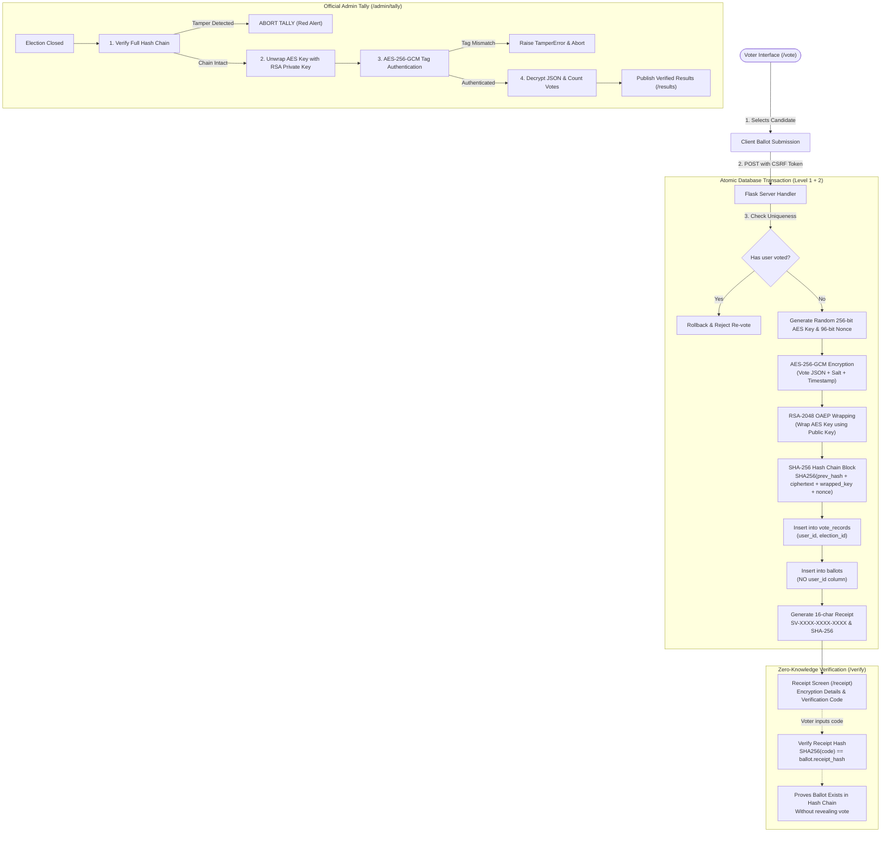

# SecureVote: Secure Online Voting Data System using RSA + AES

A complete, production-grade web application for secure, verifiable, and confidential online voting. SecureVote implements a state-of-the-art **Hybrid Cryptographic Architecture** combining asymmetric **RSA-2048** key encapsulation with symmetric authenticated **AES-256-GCM** encryption and an immutable **SHA-256 linear hash chain**.

---

## 1. Project Overview & Cryptographic Architecture

### Key Security Properties:
1. **Confidentiality & Ballot Secrecy**: Ballots are encrypted with a fresh random 256-bit AES key per vote, which is encapsulated using the election's RSA-2048 public key (OAEP with SHA-256).
2. **Authenticity & Integrity**: AES-256-GCM authenticated encryption computes a 16-byte authentication tag per ballot. If ciphertext is altered in storage, decryption fails with `TamperError`.
3. **Immutability (SHA-256 Hash Chain)**: Each ballot references and signs the previous ballot's hash:
   $$\text{ballot\_hash} = \text{SHA256}(\text{prev\_hash} + \text{ciphertext} + \text{wrapped\_aes\_key} + \text{nonce})$$
   Any deletion, modification, or reordering breaks the chain immediately.
4. **Zero Re-Voting Enforcement (Triple-Tier Defense)**:
   - **Database Level**: `UNIQUE(user_id, election_id)` on `vote_records`.
   - **Server Level**: Atomic transaction pre-check and rollback.
   - **UI Level**: Dynamic button disabling, badge status indicators, and route guards.
5. **Voter Anonymity**: The `ballots` table contains **no user ID**. Participation (`vote_records`) records *that* a citizen voted, never *what* they voted for.
6. **Zero-Knowledge Voter Receipt**: A random 16-character receipt code (`SV-XXXX-XXXX-XXXX`) is issued. Only its SHA-256 hash is recorded. Citizens can independently verify ballot inclusion on `/verify` without revealing their choice.
7. **Security Hardening**:
   - Scrypt password hashing with Werkzeug.
   - Brute-force protection: Account locked for 5 minutes after 5 consecutive failed attempts.
   - Full CSRF protection on all forms via Flask-WTF.
   - Strict HTTP security headers (CSP, X-Frame-Options: DENY, X-Content-Type-Options: nosniff).
   - Parameterized SQL queries preventing SQL injection.

---

## 2. Vote Flow & Cryptographic Architecture Diagram



---

## 3. Technology Stack

- **Backend**: Python 3.10+, Flask, Flask-WTF (CSRF), SQLite3, Werkzeug password hashing.
- **Cryptography**: `cryptography` library (RSA-2048 OAEP SHA-256, AES-256-GCM authenticated cipher).
- **Frontend**: Custom Glassmorphism UI (HTML5, Jinja2, vanilla modern CSS and JavaScript, Google Font Inter).
- **Testing**: `pytest` comprehensive test suite.

---

## 4. Setup & Running in Windows PowerShell

Open PowerShell and navigate to the project directory:

```powershell
# 1. Create Python virtual environment
python -m venv venv

# 2. Activate virtual environment
venv\Scripts\Activate.ps1

# 3. Install dependencies
pip install -r requirements.txt

# 4. Initialize database, generate RSA keys, and seed demo data
python seed.py

# 5. Run automated test suite
pytest -v

# 6. Launch the SecureVote web application
python app.py
```

Open your browser at: **`http://127.0.0.1:5000`**

---

## 5. Demo Credentials

The seed script (`python seed.py`) configures the following certified accounts:

| Role | Email Address | Password | Voter ID | Purpose |
| :--- | :--- | :--- | :--- | :--- |
| **Administrator** | `admin@securevote.com` | `Admin@123` | `ADM-0001` | Election lifecycle, auditing, running cryptographic tally |
| **Voter 1 (Alice)** | `alice@securevote.com` | `Voter@123` | `VOT-1001` | Casting confidential ballots |
| **Voter 2 (Bob)** | `bob@securevote.com` | `Voter@123` | `VOT-1002` | Casting confidential ballots |
| **Voter 3 (Charlie)** | `charlie@securevote.com` | `Voter@123` | `VOT-1003` | Casting confidential ballots |

> **Quick Demo Tip**: The login screen includes clickable 1-click autofill badges for all demo accounts.

---

## 6. End-to-End Demonstration Walkthrough

1. **Voter Registration & Authentication**:
   - Navigate to `/login` and sign in with `alice@securevote.com` / `Voter@123`.
2. **Casting a Confidential Vote**:
   - Go to `/dashboard` and click **"Cast Confidential Vote"** on the *2026 National Presidential Election*.
   - Select a candidate (e.g., Dr. Evelyn Reed).
   - Click **"Seal & Submit Ballot"**. A confirmation modal will appear: *"Are you sure? You cannot change your vote."*
   - Confirm to trigger the live AES-GCM + RSA sealing animation.
3. **Inspecting the Cryptographic Receipt**:
   - View your anonymous 16-character code (e.g. `SV-XXXX-XXXX-XXXX`).
   - Examine the **"Encryption Details"** panel showing the shortened AES-256 ciphertext, RSA-wrapped symmetric key, 96-bit nonce, and SHA-256 ballot hash.
4. **Verifying Single-Vote Enforcement**:
   - Return to `/dashboard`. Notice the card displays: `You have already voted ✔` and the Vote button is disabled.
   - Attempting to visit `/vote/1` directly redirects back with a warning: *"You have already voted in this election. Re-voting is strictly forbidden."*
5. **Zero-Knowledge Independent Verification**:
   - Navigate to `/verify`, enter your 16-character code, and verify that the ballot is recorded in the blockchain-style ledger without disclosing your vote.
6. **Closing Election & Cryptographic Tallying (Admin)**:
   - Log out, then log in as `admin@securevote.com` / `Admin@123`.
   - Access the **Admin Console** (`/admin`).
   - Click **"Close Election"** for the presidential election.
   - Click **"Execute Tally"** (`/admin/tally/1`).
   - Click **"Execute Cryptographic Tally"**: The server verifies the entire SHA-256 hash chain, unwraps each AES key with the RSA private key, checks the GCM authentication tag, and tallies results.
   - View the certified results chart with the winning candidate highlighted.

