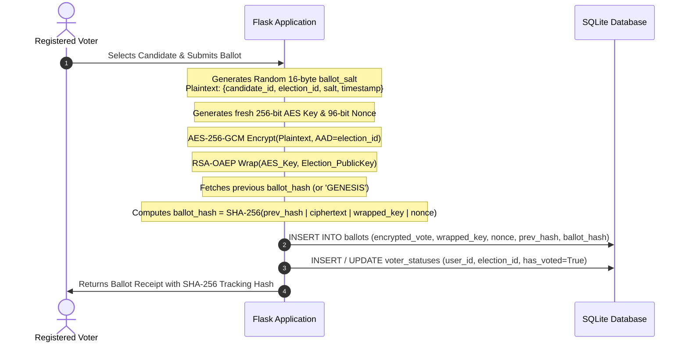
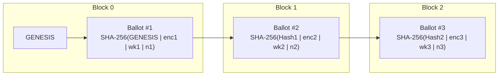

# 🔒 Secure Online Voting Data System using RSA + AES

A high-assurance, end-to-end verifiable online voting web application built in Python/Flask. Every cast ballot is protected using **Hybrid Encryption (AES-256-GCM + RSA-2048 OAEP)**, bound into an immutable **SHA-256 Hash Chain**, and certified upon tallying with **RSA-PSS Digital Signatures**.

---

## 🏛️ System Overview & Core Capabilities

- **Hybrid Encryption**: Ballots are encrypted with fresh 256-bit AES-GCM keys. The AES key is enveloped using the election's RSA-2048 public key (OAEP with SHA-256 and MGF1-SHA256).
- **Voter Anonymity (Zero-Linkage)**: Voter participation is recorded in `VoterStatus (user_id, election_id, has_voted)` and votes are stored in a separate `Ballot` table with **NO `user_id`**, mathematically decoupling identity from choices.
- **Vote Indistinguishability**: A cryptographically random 16-byte `ballot_salt` is combined with candidate data so identical choices produce totally distinct ciphertexts.
- **Tamper-Evident Hash Chain**: Each ballot links to the preceding ballot hash: `SHA-256(prev_hash | encrypted_vote | wrapped_key | nonce)`. Any DB tampering, reordering, or deletion is instantly detected.
- **Certified Tallies via RSA-PSS**: Tally results are decrypted using the admin's offline private key and certified using RSA-PSS digital signatures with SHA-256.
- **Defensive Authentication**: Argon2id password hashing, session cookies (`HttpOnly`, `SameSite=Lax`), brute-force lockout after 5 attempts (15-min lockout), and Flask-Limiter rate limiting.
- **Public Ballot Verification**: Voters receive a receipt containing their ballot tracking hash and can independently audit the public chain.

---

## 📐 Cryptographic Architecture

### 1. Hybrid Encryption Flow (Ballot Casting)



---

### 2. Hash Chain & Ballot Node Structure



---

## 🚀 Quickstart & Setup Guide (PowerShell)

### Prerequisites
- Python 3.11+ installed on Windows.
- PowerShell terminal.

### 1. Set Up Virtual Environment & Dependencies
```powershell
# Navigate to the project directory
cd "C:\Users\Deeraj Prasad S P\.gemini\antigravity-ide\scratch\voting-system"

# Create virtual environment
python -m venv venv

# Activate virtual environment
.\venv\Scripts\Activate.ps1

# Install requirements
pip install -r requirements.txt
```

### 2. Initialize Keys and Seed Demo Database
```powershell
# Seed the database with Admin, 5 Voters, an Election, and 3 Candidates
python scripts\seed_demo.py
```

### 3. Run the Development Server
```powershell
python -m flask run --port 5000
```
Open your browser at **[http://127.0.0.1:5000](http://127.0.0.1:5000)**.

---

## 🧪 Running Automated Tests

A comprehensive `pytest` test suite validates all cryptographic primitives, voting flows, tamper detection, and role-based access control.

```powershell
# Run all tests with verbose output
.\venv\Scripts\pytest.exe -v
```

### Test Coverage Highlights:
- **`test_crypto.py`**:
  - RSA-2048 key generation, passphrase encryption, and loading.
  - AES-256-GCM authenticated encryption/decryption roundtrips.
  - AES-256-GCM ciphertext/nonce tampering detection (`InvalidTag`).
  - RSA-OAEP key wrapping/unwrapping.
  - Indistinguishable encryption of identical votes via ballot salts.
  - SHA-256 hash chain verification, tamper detection, and deletion detection.
  - RSA-PSS digital signature generation and verification.
- **`test_voting_flow.py`**:
  - Voter registration and password complexity validation.
  - Argon2 login and 5-attempt account lockout.
  - Single vote submission and cryptographic receipt generation.
  - Double voting prevention (One-Person-One-Vote).
  - Voting outside active window / draft election rejection.
  - Role-based authorization: non-admin blocked from admin endpoints (HTTP 403).
  - Complete election lifecycle: create $\to$ candidates $\to$ open $\to$ vote $\to$ close $\to$ tally $\to$ certified signed results.
  - Public receipt verification.
- **`test_tamper.py`**:
  - Direct database row alteration detection.
  - Intermediate ballot deletion detection.
  - Tally protocol automatic abort on hash chain integrity violation.

---

## 👥 Demo Credentials

| Role | Name | Email / Identifier | Password | Voter ID |
| :--- | :--- | :--- | :--- | :--- |
| **Admin** | Chief Election Officer | `admin@election.gov` | `Admin@Secure2026!` | `ADMIN-001` |
| **Voter** | Alice Walker | `alice@vote.com` | `Voter@Secure2026!` | `VOTER-1001` |
| **Voter** | Bob Miller | `bob@vote.com` | `Voter@Secure2026!` | `VOTER-1002` |
| **Voter** | Charlie Davis | `charlie@vote.com` | `Voter@Secure2026!` | `VOTER-1003` |
| **Voter** | Diana Prince | `diana@vote.com` | `Voter@Secure2026!` | `VOTER-1004` |
| **Voter** | Edward Norton | `edward@vote.com` | `Voter@Secure2026!` | `VOTER-1005` |

**Demo Election Private Key Passphrase:** `DemoElectionPassphrase2026!`  
*(The encrypted private key file is located at `demo_private_key.pem` for tallying)*

---

## 🛡️ Security Design & Threat Model

| Threat / Attack Vector | Cryptographic / System Mitigation |
| :--- | :--- |
| **Ballot Eavesdropping** | Ballots are encrypted with **AES-256-GCM**. The symmetric key is encrypted with **RSA-2048 OAEP** using the election's public key. Plaintext is never stored. |
| **Database Tampering / Vote Alteration** | AES-256-GCM tag verification catches any ciphertext alteration. SHA-256 hash chaining detects modified blocks, broken parent links, or deleted records. |
| **Double Voting** | Enforced with an atomic database unique constraint on `VoterStatus(user_id, election_id)`. |
| **Voter Coercion / De-anonymization** | Separate `VoterStatus` table stores participation only (`has_voted=True`). The `Ballot` table contains **zero foreign keys** or references to voter identity. |
| **Traffic / Ciphertext Analysis** | Each ballot includes a fresh 16-byte cryptographically secure random `ballot_salt` (`os.urandom(16)`), making two votes for the same candidate indistinguishable. |
| **Private Key Compromise in DB** | Zero-Knowledge Key Storage: The election private key is **never stored** in the database or server disk. The administrator retains the passphrase-protected PEM file offline until tallying. |
| **Forged Results / Malicious Tally** | Tally summaries are digitally signed with **RSA-PSS (SHA-256)** by the private key holder. The public results page cryptographically validates this signature before display. |
| **Credential Brute Force / Dictionary Attacks** | **Argon2id** password hashing with salt. Account locked for 15 minutes after 5 failed attempts. Flask-Limiter enforces route-level rate limits. |
| **Cross-Site Scripting (XSS) & Clickjacking** | Strict Content-Security-Policy (CSP), `X-Frame-Options: DENY`, `X-Content-Type-Options: nosniff`, and `HttpOnly`, `SameSite=Lax` cookies. |

---

## 🎓 College Viva / Project Defense: "How the Encryption Works"

> **Plain-Language Explanation for Examiners & Evaluators:**

1. **Why Hybrid Encryption?**
   - Asymmetric encryption (RSA) is ideal for key distribution (anyone can encrypt with the public key, only the election authority can decrypt with the private key), but RSA alone is computationally slower and has strict payload size limits.
   - Symmetric encryption (AES-256-GCM) is extremely fast and provides authenticated encryption with associated data (AEAD).
   - **Hybrid Solution**: For each vote cast, the application generates a fresh, random 256-bit AES key and encrypts the ballot. It then locks ("wraps") only the AES key using RSA-2048 OAEP. The database stores the encrypted ballot together with the wrapped key and nonce.

2. **How is Voter Anonymity Preserved?**
   - The system separates *eligibility tracking* from *ballot storage*.
   - When Alice votes, the system updates `VoterStatus` stating "Alice has voted in Election #1" to prevent double voting.
   - The encrypted ballot itself is stored in the `Ballot` table with **no user ID, no IP address, and no reference to Alice**.

3. **How Does the Hash Chain Prevent Fraud?**
   - Each ballot contains a `prev_hash` pointing to the previous ballot's hash, forming a linear cryptographic chain (like a lightweight blockchain).
   - If a malicious database administrator attempts to modify a ballot, insert an unauthorized vote, or delete an opposition vote, the SHA-256 chain links break immediately, causing the automated integrity check and the final tally to halt and alert.

4. **How are Results Certified?**
   - When the election closes, the administrator uploads their encrypted private key and enters their passphrase.
   - The system verifies the hash chain first, decrypts all ballots, tallies the votes, and signs the tally JSON with **RSA-PSS**. Anyone can verify the authenticity of the published election results using the election's public key.

---

## 📁 Repository File Structure

```
voting-system/
├── app.py                  # Application factory, security headers, error handlers
├── config.py               # Config classes (Dev, Test, Prod)
├── models.py               # SQLAlchemy models (User, Election, Candidate, VoterStatus, Ballot, AuditLog)
├── crypto_utils.py         # All RSA-2048, AES-256-GCM, Hash Chaining & RSA-PSS operations
├── auth_utils.py           # Authentication decorators & password complexity checks
├── audit_utils.py          # Centralized audit logger
├── forms.py                # Flask-WTF forms with CSRF validation
├── routes/
│   ├── __init__.py         # Blueprint exports
│   ├── auth.py             # Register, Login (lockout + Argon2), Logout
│   ├── voter.py            # Dashboard, Encrypted Vote, Receipt, Public Verification
│   └── admin.py            # Election Lifecycle, Candidates, Tally, Integrity Check, Export
├── templates/
│   ├── base.html           # Dark cyber-sleek base layout with navbar & flash alerts
│   ├── auth/               # Login & Register views
│   ├── voter/              # Dashboard, Ballot Selection, Receipt, Verify, Results
│   ├── admin/              # Admin Dashboard, Create Election, Candidates, Key Download, Tally, Verify, Audit
│   └── errors/             # 400, 403, 404, 429, 500 error templates
├── static/
│   ├── css/style.css       # Premium custom CSS design system
│   └── js/main.js          # Clipboard helpers & dynamic interactive forms
├── scripts/
│   ├── generate_keys.py    # Standalone RSA keypair generator CLI
│   ├── seed_demo.py        # Database seed script for demo environment
│   └── verify_live_flow.py # Live HTTP verification script
├── tests/
│   ├── __init__.py
│   ├── conftest.py         # Pytest fixtures and test application setup
│   ├── test_crypto.py      # Cryptographic primitive unit tests
│   ├── test_voting_flow.py # Complete voting lifecycle and auth tests
│   └── test_tamper.py      # Database tampering and chain integrity tests
├── requirements.txt        # Project dependencies
├── .env.example            # Environment template
└── README.md               # Project documentation
```
